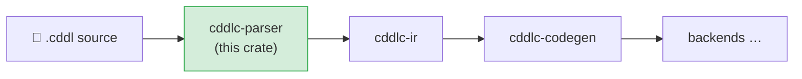

# cddlc-parser

Converts CDDL source text into a structured Abstract Syntax Tree (AST).  This is the first
stage in the `cddlc` pipeline — it knows nothing about semantics, name resolution, or code
generation; it only concerns itself with what is grammatically correct CDDL.

## Position in the pipeline



## What it does

1. **Tokenises** the source character-by-character using the
   [winnow](https://docs.rs/winnow) parser-combinator library.
2. **Parses** the full RFC 8610 grammar — rules, type expressions, groups, occurrence
   indicators, constraints, generics, CBOR tag literals (`#6.N(T)`), and literal values.
3. **Extracts pragmas** — structured `;`-comments of the form `; @keyword value`
   that appear on the line immediately before a rule, and also file-level pragma blocks
   (e.g. `; @import "path"`).
4. **Attaches source spans** to every node so downstream crates can produce accurate
   diagnostics with file name, line, and column information.
5. Returns a **`CddlModule`** — the top-level AST container.

## Public API

```rust
// Parse a single source string into a CddlModule
pub fn parse_cddl(source: &str, path: Option<&Path>) -> Result<CddlModule, ParseError>;

// Top-level AST container
pub struct CddlModule {
    pub source_path: PathBuf,      // File the rules came from
    pub file_pragmas: Vec<Pragma>, // File-scope pragmas (@import …)
    pub rules: Vec<Rule>,          // One entry per CDDL rule
}
```

Key AST types:

| Type | Description |
|---|---|
| `Rule` | One `name = type-expr` or `name //= type-expr` definition |
| `TypeExpr` | A CDDL type expression (choice, group ref, primitive, literal, etc.) |
| `GroupEntry` | One field inside `{ … }` or `[ … ]` |
| `Occurrence` | `?`, `*`, `+`, `n*m` |
| `Constraint` | `.size`, `.range`, `.ge/.le`, `.regexp`, `.cbor`, `.cborseq`, … |
| `Pragma` | `@keyword value` parsed from a `;`-comment |
| `Span` / `Spanned<T>` | Source location wrapper used on every node |
| `Ident` | A CDDL identifier with its source span |

## Pragma syntax

Pragmas are `;`-comments with a structured keyword-value syntax.  The parser recognises:

```
; @import "relative/path.cddl"
; @capacity 32
; @str-capacity 64
; @doc "Human-readable description"
; @deprecated
; @default 0
; @regex-hook validate_uuid
; @skip-validation
; @opaque
```

A pragma attached to a rule must appear on the line immediately preceding it.
A file-level pragma (e.g. `@import`) may appear anywhere in the file and is collected in
`CddlModule::file_pragmas`.

## Grammar coverage

The parser covers the full RFC 8610 ABNF plus the following:

| Feature | Example |
|---|---|
| Primitive types | `bool`, `uint`, `int`, `float16/32/64`, `tstr`, `bstr`, `nil`, `any` |
| Named types | `device-id`, `SensorReading` |
| Map structs | `{ key: T, ? opt: T, 1: T }` |
| Array groups | `[* T]`, `[+ T]`, `[1*3 T]` |
| Type choices | `"ok" / "warn" / "error"`, `1 / 2 / 3` |
| Group choices | `(a // b)` |
| Generics | `pair<T> = [T, T]`, usage `pair<uint>` |
| CBOR tags | `#6.1(uint)` |
| Constraints | `.size N`, `.size (min..max)`, `.ge N`, `.regexp "pat"`, `.cbor T` |
| Integer map keys | `{ 1: T }` |
| Unwrapped groups | `~group-name` |
| Socket/plug | `$rule /= T` (parsed; limited lowering support) |
| Embedded CBOR | `.cbor T`, `.cborseq T` |

## Error handling

`ParseError` carries the source span of the failure and a human-readable message.  Enable
detailed parse tracing via `CDDLC_TRACE=1` or the CLI `--debug-parse` flag.

## Known gaps and future enhancements

- **Error recovery**: parse errors are fatal; there is no partial-parse / error-recovery mode
  to continue collecting diagnostics after the first failure.
- **Pre-built line map**: spans record character offsets only; line/column computation is
  done on demand and could be precomputed for large files.
- **Full `//=` socket/plug augmentation**: multi-file augmentation sets are tokenised but the
  AST does not fully model them — `cddlc-ir` receives them as raw rules.
- **CDDL 2.0 / RFC 9682 extensions**: the parser targets RFC 8610.  Newer control operators
  and extended type definitions are not yet supported.
- **Stacked multi-line pragma blocks**: only the immediately preceding line is scanned for
  pragmas; multiple consecutive pragma lines above a rule are not coalesced.

## License

MIT OR Apache-2.0
